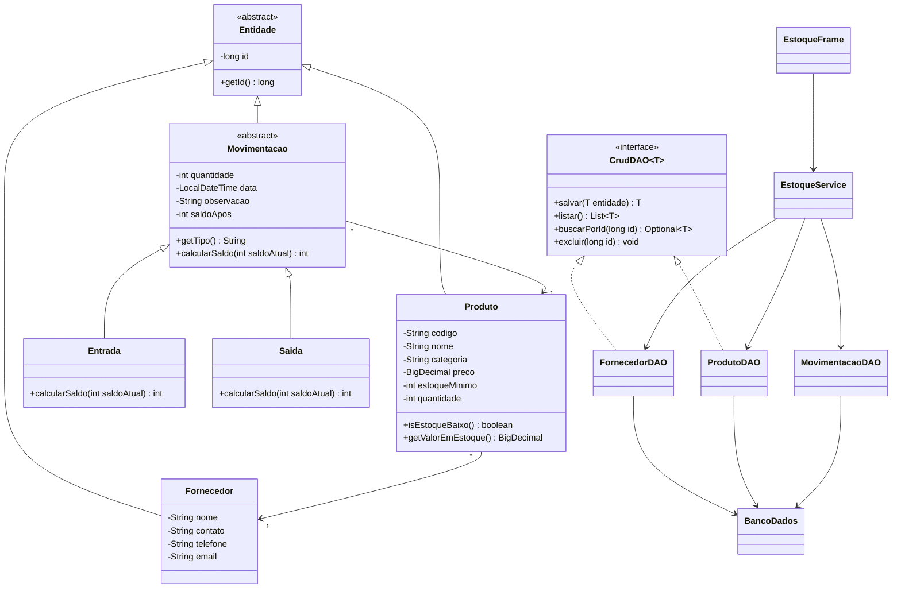
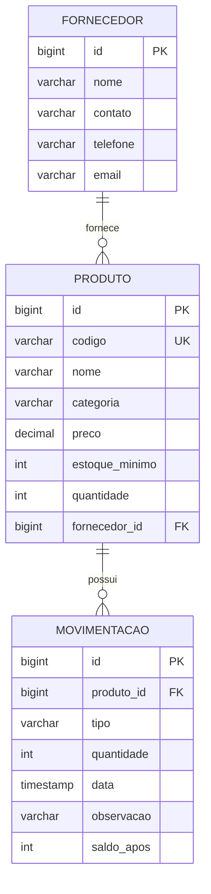
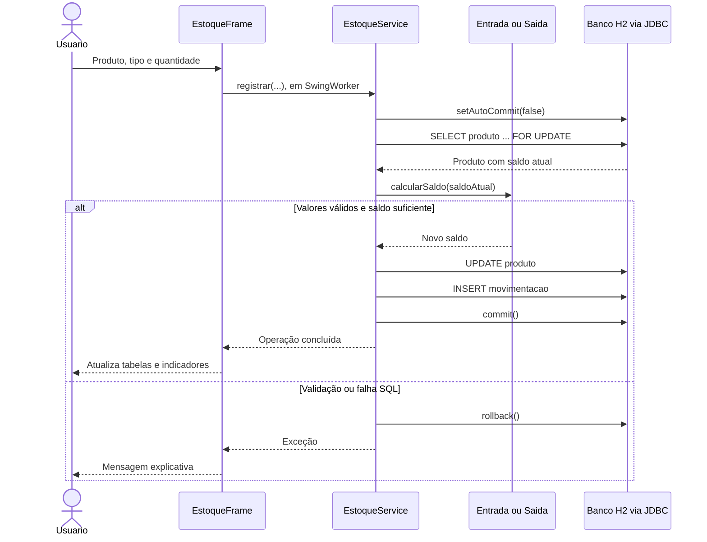

# Diagramas da aplicação

Os blocos Mermaid podem ser visualizados em editores que suportem esse formato. A descrição textual também registra as relações.

## Classes de domínio e persistência

`Entidade` é a base das entidades persistidas. `Movimentacao` acrescenta um contrato abstrato implementado por `Entrada` e `Saida`. Cada produto referencia um fornecedor e cada movimentação referencia um produto. A interface gráfica depende do serviço, que coordena a persistência por DAOs.

## Modelo relacional

## Transação de movimentação

